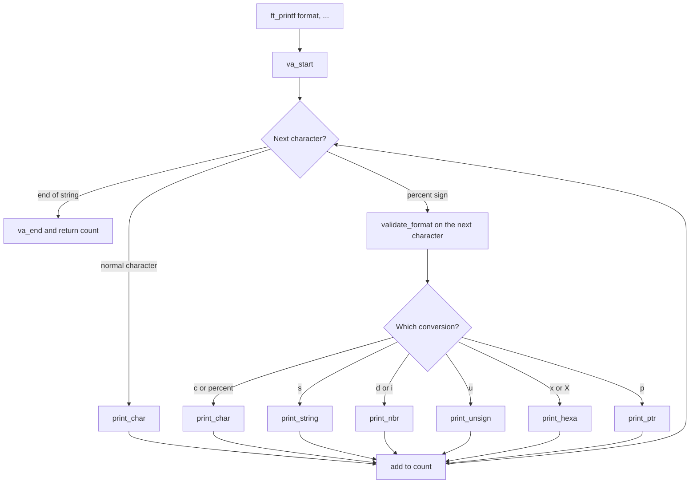

*This project has been created as part of the 42 curriculum by fercarva.*

<h1 align="center">🖨️ ft_printf</h1>

---

<p align="center">
My second C project: <code>printf()</code> rebuilt from scratch with variadic arguments.<br>
A <b>42 Porto</b> project.
</p>

<p align="center">
  
  
  
</p>

---

## 🧭 Quick navigation

| I want to see... | Go to |
| --- | --- |
| How to build and use it | [⚙️ Build and use](#instructions) |
| Which conversions are supported | [📋 Supported conversions](#supported-conversions) |
| How the function works step by step | [🔄 How it works](#how-it-works) |
| Why this algorithm and these types | [🧠 Algorithm and data structure](#algorithm-and-data-structure) |
| How to test it | [🧪 Testing](#testing) |
| Classic references | [📚 Resources](#resources) |
| How AI was used in this project | [🤖 AI usage](#how-ai-was-used) |

---

## Description

`ft_printf` is a from-scratch recode of the C library function `printf()`.
It prints formatted text to the standard output and returns the number of characters written.

**Goal:** learn how **variadic functions** work in C (`va_list`, `va_start`, `va_arg`, `va_end`) and how to build code that is small, readable and easy to extend.

**Overview:**

| Item | Value |
| --- | --- |
| Library name | `libftprintf.a` |
| Prototype | `int ft_printf(const char *format, ...);` |
| Header | `ft_printf.h` |
| Allowed functions | `malloc`, `free`, `write`, `va_start`, `va_arg`, `va_copy`, `va_end` |
| Buffer management | None (as required by the subject) |
| Bonus | Not implemented |

---

## Instructions

### Compile

```bash
make
```

This creates `libftprintf.a` at the root of the repository, using `cc -Wall -Wextra -Werror` and `ar rcs`.

### Makefile rules

| Rule | What it does |
| --- | --- |
| `make` / `make all` | Builds `libftprintf.a` |
| `make clean` | Removes the object files (`.o`) |
| `make fclean` | Removes the object files and `libftprintf.a` |
| `make re` | Full rebuild (`fclean` + `all`) |
| `make norm` | Runs `norminette` on the sources and the header |

The Makefile does not relink if nothing changed.

### Use it in your own program

```c
#include "ft_printf.h"

int main(void)
{
    int len;

    len = ft_printf("Hello %s! You are %d years old. (%x)\n", "42", 7, 255);
    ft_printf("Printed %d characters\n", len);
    return (0);
}
```

```bash
cc -Wall -Wextra -Werror main.c -L. -lftprintf -o demo
./demo
```

<details>
<summary><b>Project files (click to open)</b></summary>

| File | Role |
| --- | --- |
| `ft_printf.h` | Header: includes and prototypes |
| `ft_printf.c` | `ft_printf()`, the format dispatcher (`validate_format`) and `print_char` |
| `ft_printf_utils.c` | Printing helpers: string, signed, unsigned, hexadecimal, pointer |
| `Makefile` | Builds the static library with `ar` |

</details>

---

## Supported conversions

| Conversion | Prints | Argument type | Example | Output |
| :---: | --- | --- | --- | --- |
| `%c` | A single character | `int` | `ft_printf("%c", 'A')` | `A` |
| `%s` | A string | `char *` | `ft_printf("%s", "hi")` | `hi` |
| `%p` | A pointer in hexadecimal | `void *` | `ft_printf("%p", ptr)` | `0x7ffd...` |
| `%d` | A signed decimal number | `int` | `ft_printf("%d", -42)` | `-42` |
| `%i` | A signed integer (base 10) | `int` | `ft_printf("%i", 42)` | `42` |
| `%u` | An unsigned decimal number | `unsigned int` | `ft_printf("%u", 42)` | `42` |
| `%x` | Hexadecimal, lowercase | `unsigned int` | `ft_printf("%x", 255)` | `ff` |
| `%X` | Hexadecimal, uppercase | `unsigned int` | `ft_printf("%X", 255)` | `FF` |
| `%%` | A percent sign | none | `ft_printf("%%")` | `%` |

<details>
<summary><b>Behaviour you should know about (click to open)</b></summary>

- **Return value:** the total number of characters written, like the original `printf`.
- **`%s` with `NULL`:** prints `(null)`.
- **`%p` with `NULL`:** prints `(nil)`. Any other pointer is printed with a `0x` prefix.
- **`%d` with `INT_MIN`:** works correctly (see [why `long` is used](#why-these-choices)).
- **`%x` / `%X` with negative values:** the value is read as an `unsigned int`, like the original.
- **Not handled:** flags, width and precision (these belong to the bonus part).

</details>

---

## How it works

`ft_printf` reads the format string once, from left to right.
Normal characters are printed directly. When a `%` is found, the next character decides which printing function is used.



<details>
<summary><b>Step by step example: <code>ft_printf("Id: %d!\n", 42)</code></b></summary>

1. `I`, `d`, `:`, ` ` are normal characters, so each one goes to `print_char` (count = 4).
2. `%` is found, so `validate_format('d', args)` is called.
3. `va_arg(args, int)` gives `42`, and `print_nbr(42)` prints `4` then `2` (count = 6).
4. `!` and `\n` are printed (count = 8).
5. The end of the string is reached, `va_end` is called and `8` is returned.

</details>

---

## Algorithm and data structure

### The algorithm

1. **Single pass over the format string.** An index `i` walks through the string. A `%` consumes two characters (`%` and the conversion letter); anything else consumes one.
2. **Dispatch by conversion letter.** `validate_format` compares the letter against each supported conversion and calls the matching helper. Each helper returns how many characters it printed, and `ft_printf` adds them all in one counter.
3. **Recursive number printing.** Numbers are printed digit by digit using recursion: print the quotient first (`nb / base`), then the last digit (`nb % base`). This outputs digits in the correct order without needing to reverse anything.

```text
print_nbr(42):
    42 > 9  ->  print_nbr(4)  ->  prints '4'
                prints (42 % 10) = '2'
    result: "42"
```

4. **Hexadecimal with a lookup string.** `print_hexa` receives the digit table as an argument (`"0123456789abcdef"` or `"0123456789ABCDEF"`). The same function therefore serves `%x`, `%X` and `%p`, and only the table changes.

### The data structure

There is **no complex data structure**, and that is deliberate:

| What | Used for |
| --- | --- |
| `va_list` | Walks through the variable arguments |
| `int count` | Accumulates the number of printed characters (the return value) |
| `char *` digit tables | Convert a digit value to its character (lowercase or uppercase hex) |
| The call stack | Stores the pending digits during the recursive printing |

### Why these choices

- **No buffer, no `malloc`.** The subject forbids implementing the original buffer management, and nothing here needs dynamic memory, so there is nothing to leak or free.
- **`long` inside `print_nbr`.** `-INT_MIN` does not fit in an `int`. Storing the value in a `long` before negating it makes `INT_MIN` safe.
- **`unsigned long` inside `print_hexa`.** It is large enough for a 64-bit pointer, so `%x`, `%X` and `%p` can share one function.
- **Recursion depth is tiny.** At most 10 levels for decimal (`int`/`unsigned int`) and 16 for hexadecimal (`unsigned long`), so stack usage is negligible.
- **One `write` per character.** This is the simplest correct approach without a buffer. The trade-off is more system calls, which is acceptable because the subject asks us not to buffer.
- **One function per conversion.** Adding a new conversion means writing one helper and adding one line to `validate_format`. This keeps the code extensible, as the subject recommends.

**Complexity:** time is O(n + d), where *n* is the length of the format string and *d* the total number of digits and characters printed. Extra memory is O(1) apart from the shallow recursion stack.

---

## Testing

The mandatory conversions were compared against the original `printf()` with edge cases such as `INT_MIN`, `INT_MAX`, `UINT_MAX`, `LONG_MIN`, `LONG_MAX`, `ULONG_MAX`, `NULL` strings and `NULL` pointers.
[Francinette](https://github.com/xicodomingues/francinette) (with its `printfTester`) is a convenient way to run these checks:

```bash
francinette
```

---

## Resources

### Classic references

- [`man 3 printf`](https://man7.org/linux/man-pages/man3/printf.3.html): behaviour of the original function.
- [`man 3 stdarg`](https://man7.org/linux/man-pages/man3/stdarg.3.html): `va_start`, `va_arg`, `va_copy`, `va_end`.
- [`man 2 write`](https://man7.org/linux/man-pages/man2/write.2.html): the only output function used.
- [The Norm (42 style guide)](https://github.com/42School/norminette): coding rules followed in this project.
- Brian W. Kernighan and Dennis M. Ritchie, *The C Programming Language*: chapter on variable-length argument lists.

### How AI was used

In line with the 42 AI guidelines, AI was used as a learning and documentation helper, not to write the project's logic for me:

| Task | How AI helped |
| --- | --- |
| Understanding concepts | Explanations of how variadic functions and `va_list` work |
| Debugging | Hints (not full solutions) about why some `%p` tests failed with extreme values such as `LONG_MIN`, `LONG_MAX` and `ULONG_MAX` |
| Documentation | Writing and structuring this `README.md` |

All the code in `ft_printf.c`, `ft_printf_utils.c` and `ft_printf.h` was written, reviewed and understood by me, and I can explain every function during the peer evaluation.
